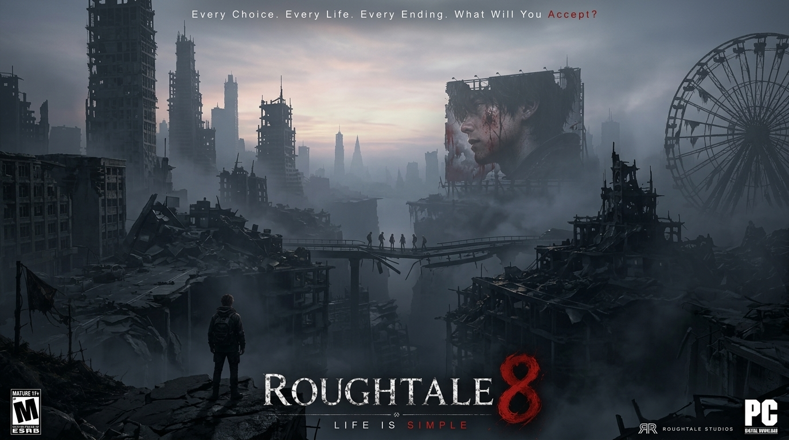
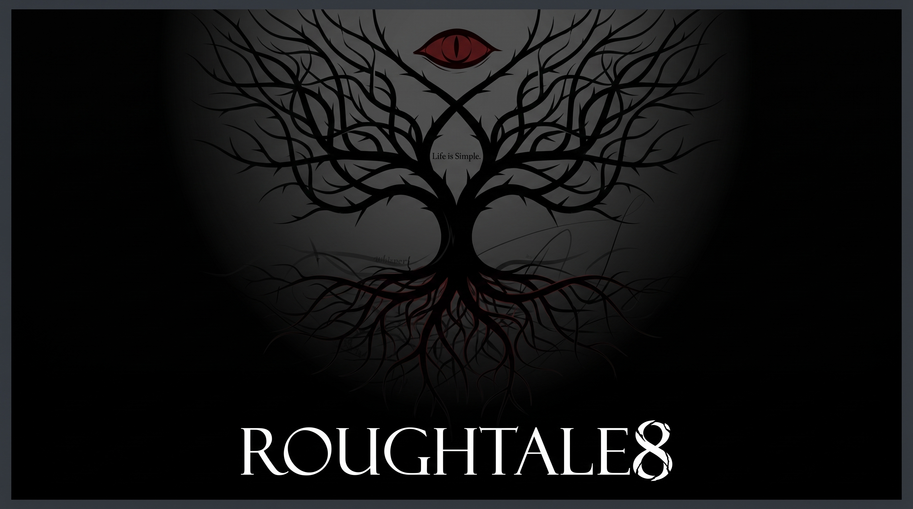
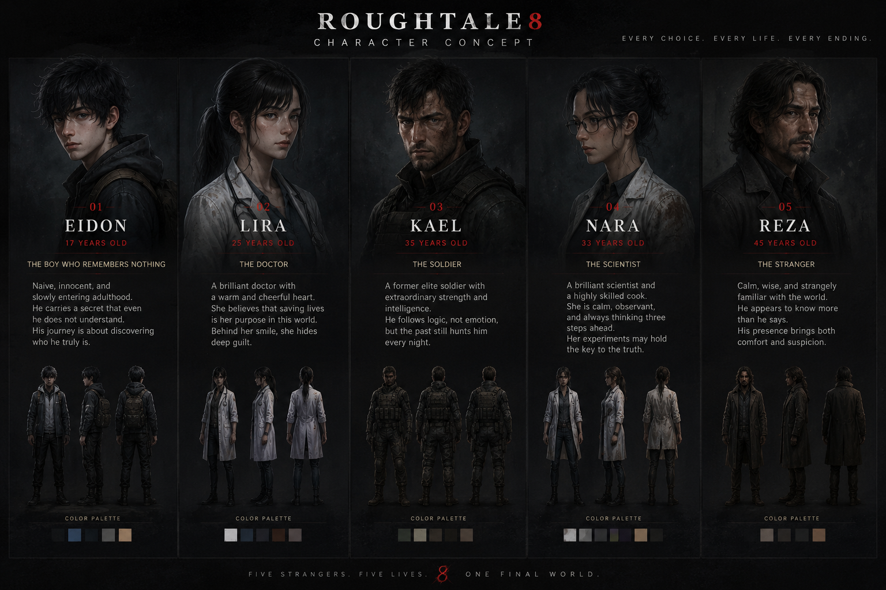
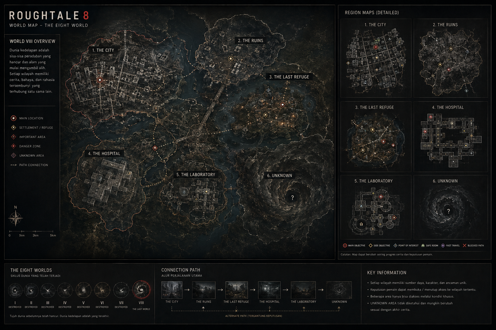
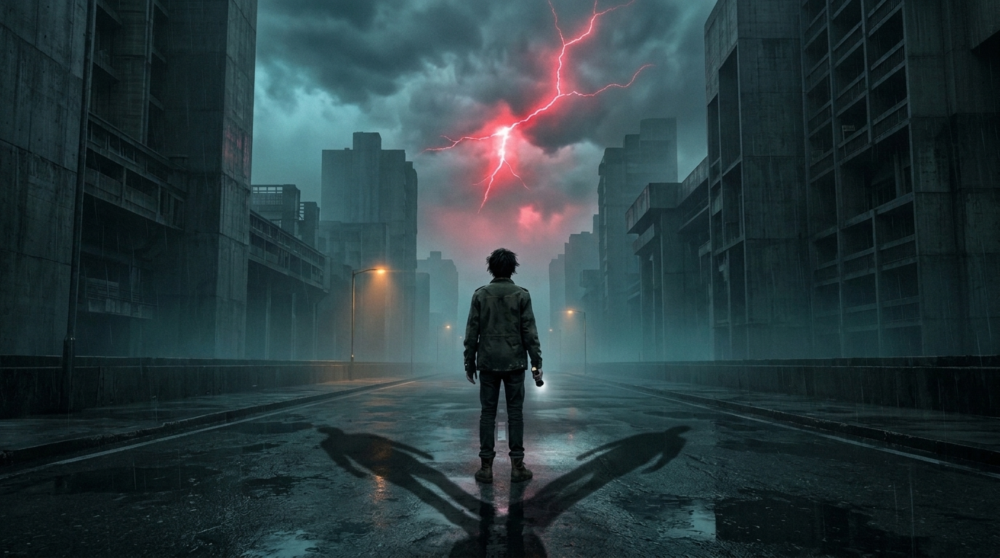
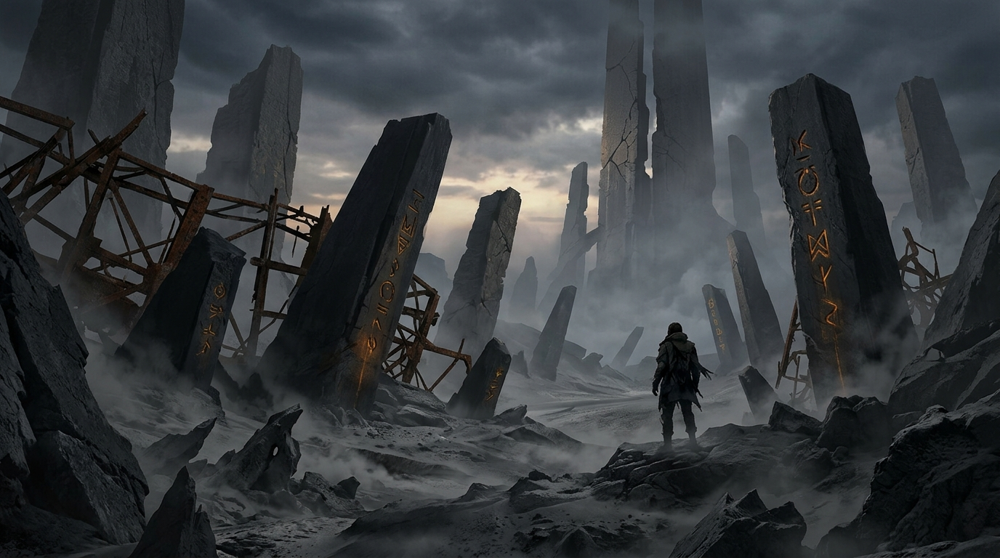
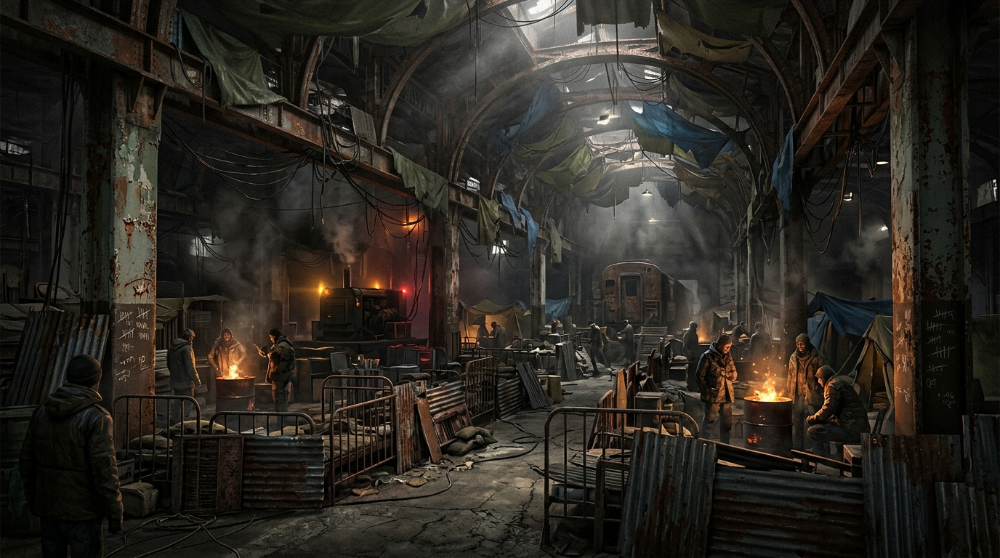
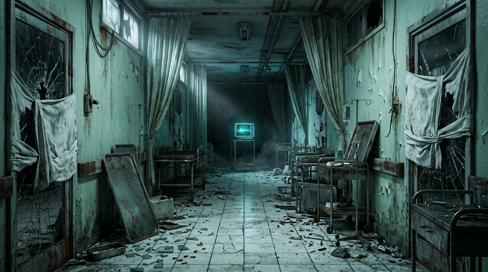
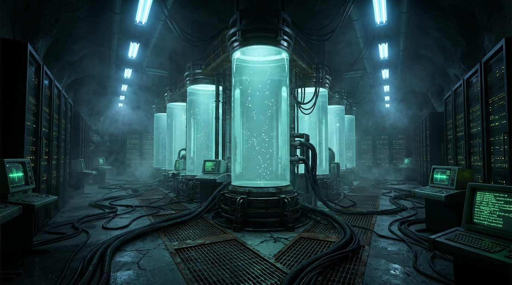
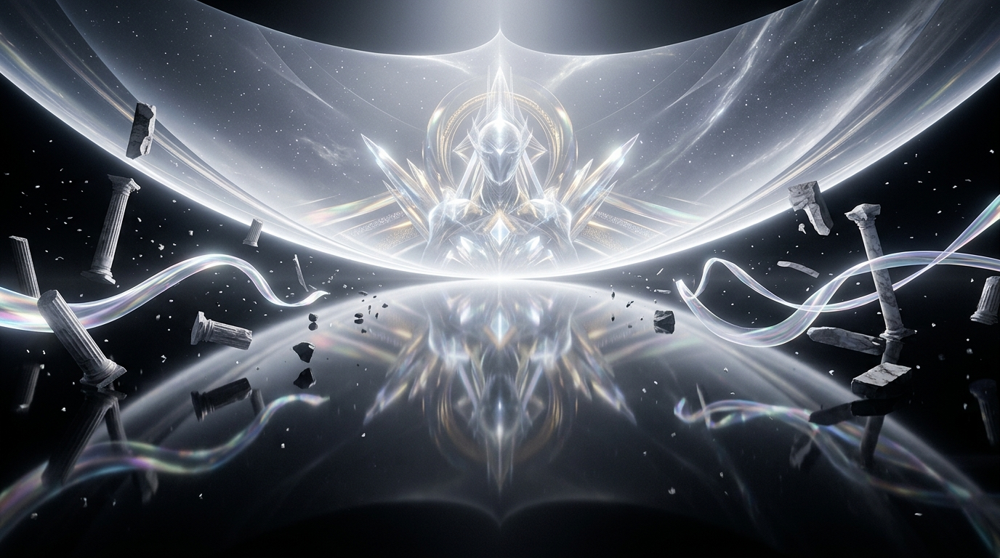

<div align="center">



# ROUGHTALE 8
### THE EIGHTH WORLD &bull; THE FINAL CYCLE

[](https://roughtale8.vercel.app)
[](https://roughtale8.vercel.app)
[](https://github.com/faarimuhammad2502)
[](https://roughtale8.vercel.app)

<br>

**AN ORIGINAL INTELLECTUAL PROPERTY & CINEMATIC NARRATIVE CONCEPT**  
*Conceived, Written, and Architected by Muhammad Faari Akbar*

[Experience Live Interactive Web Teaser](https://roughtale8.vercel.app) &bull; [Watch Teaser Cut](https://roughtale8.vercel.app/previewtrailer.html)

</div>

---

## PREMISE: THE EIGHTH CYCLE

> *"Seven civilizations collapsed into silence, ground down beneath anomalies that leave no ash behind. Now the world sits on its eighth cycle. If this cycle shatters, there will be no reset. Existence ceases entirely."*

In the wake of cataclysmic fractures across space and consciousness, reality remains suspended in an agonizing loop. Watching silently over the unraveling fabric of existence is an inscrutable cosmic entity known only as **KAMI**—an observer neither benevolent nor cruel, merely waiting for humanity's final answer.

Unlike traditional survival narratives where survival is an act of defiance, **ROUGHTALE 8** explores the terrifying anatomy of guilt, memory distortion, and the agonizing struggle toward **Acceptance**. Survival does not come from undoing what is broken; it demands confronting the irreversible consequences of every action taken.

<div align="center">



</div>

---

## FIVE CONVERGING PERSPECTIVES

Five survivors, scattered across the ruins of civilization, find their fates inextricably bound. There is no omniscient savior: the decisions, hesitations, moral failures, and sacrifices of one character directly seal the fate of the others.

<div align="center">



</div>

### 1. EIDON &bull; THE FALLEN COMMANDER
A battle-worn soldier haunted by the catastrophic orders he carried out in the prior cycle. Wielding a tactical blade in close-quarters combat, his path is driven by an obsession with redemption that borders on madness.

### 2. LIRA &bull; THE ANOMALY CATALYST
A survivor manifesting volatile, reality-bending abilities connected directly to the frequency of the eighth cycle. Her fragile psychological threshold determines whether her powers rescue or consume those around her.

### 3. KAEL &bull; THE RECON SHADOW
A pragmatic marksman and tactical scout navigating the desolate urban canyons. Equipped with precision weaponry, Kael perceives the environment through cold calculation, until his past confronts him.

### 4. NARA &bull; THE ARCHIVIST TRACKER
Armed with the legendary Obsidian Bow, Nara studies the cryptographic logs and spatial ruptures of the cycles. She races against time before her own cognitive memory degrades under the anomaly's influence.

### 5. REZA &bull; THE SIEGE ENGINEER
The desperate architect of humanity's last remaining bastion. Reza maintains defense networks and automated countermeasures while navigating paranoia and fracturing trust among the survivors.

---

## WORLD ARCHITECTURE: THE 6 CANONICAL REGIONS

<div align="center">



</div>

The topography of the 8th Cycle is a decaying landscape suspended between familiar civilization, anomalous fractures, and metaphysical horizons. Every location embodies a distinct psychological threshold and phase of the final cycle:

---

### 01. THE CITY &bull; *Eidon Awakening & Diverging Shadows*

<div align="center">



</div>

> *"A rain that never cleanses, falling across monoliths that forgot who built them."*

* **Atmospheric Mood:** Bleak, suffocating neo-brutalism, perpetual cold precipitation, wet asphalt reflecting dead violet and amber neon.
* **Narrative Significance:** Eidon awakens here in the heart of the 8th Cycle with fractured memory. The city's towering corporate spires and collapsed arterial bridges serve as the starting threshold of converging destinies.
* **Environmental Cue:** Ambient sirens fading into static drone, hollow wind tunneling through shattered glass facades.

---

### 02. THE RUINS &bull; *Monolithic Ossuary of Cycles 1–6*

<div align="center">



</div>

> *"Six worlds sleep beneath this dust. None of them left an apology."*

* **Atmospheric Mood:** Heavy silence, monolithic concrete slabs, collapsed suspension cables, anomalous gray dust.
* **Narrative Significance:** The physical graveyard of prior failed civilizations. Megastructures from cycles 1 through 6 lie fused together in geological violence, offering silent testimony that cycle reset is not salvation—it is gradual erasure.
* **Environmental Cue:** Distant groaning metal, petrified echoes, the absence of bird calls or natural life.

---

### 03. THE LAST REFUGE &bull; *Hollow Hangar Sanctuary*

<div align="center">



</div>

> *"A cage with warm lights is still a cage. But tonight, it keeps the darkness outside."*

* **Atmospheric Mood:** Industrial subterranean warmth, buzzing amber sodium lights, makeshift catwalks, diesel fumes.
* **Narrative Significance:** The fragile subterranean shelter maintained by Reza and the remaining enclave of survivors. Fortified blast doors stand between civil fragility and external anomaly.
* **Environmental Cue:** Low diesel generator hum, metal expansion pings, hushed survivor whispers, dripping ventilation pipes.

---

### 04. THE HOSPITAL &bull; *Lira's Clinical Sorrow*

<div align="center">



</div>

> *"The monitors still beep for hearts that stopped three cycles ago."*

* **Atmospheric Mood:** Eerie hospital-green glow, strobe flicker, wet linoleum floors, overturned stretchers, psychological isolation.
* **Narrative Significance:** The medical epicenter where anomaly catalysts and cognitive degradation were first documented. Lira's past and unresolved guilt echo through these claustrophobic corridors.
* **Environmental Cue:** Irregular fluorescent flicker buzz, distant arrhythmic heart monitor tone, soft metallic clatter of surgical trays.

---

### 05. THE LABORATORY &bull; *Nara's Subterranean Research Bay*

<div align="center">



</div>

> *"We measured eternity with copper wires and silicon. We were children counting stars with closed eyes."*

* **Atmospheric Mood:** High-tech subterranean decay, cyan holographic terminals, deep violet server banks, fractured glass containment cylinders.
* **Narrative Significance:** The central archive where Nara analyzes encrypted telemetry from past resets. Here, the boundary between pure science and cosmic anomaly blurs into terminal realization.
* **Environmental Cue:** High-pitched server hum, holographic cycling chimes, magnetic containment field purr.

---

### 06. UNKNOWN &bull; *KAMI's Shadowless Metaphysical Horizon*

<div align="center">



</div>

> *"Not a monster to slay. Not a god to worship. Simply the silence that remains when all questions are answered."*

* **Atmospheric Mood:** Luminous, surreal non-Euclidean geometry, floating geometric monoliths, pristine reflection pool, serene white-gold horizon.
* **Narrative Significance:** The metaphysical core beyond physical space. **KAMI** resides here not as an antagonist or destructive monster, but as an unfathomable cosmic observer awaiting humanity's genuine psychological **Acceptance**.
* **Environmental Cue:** Sub-bass drone vibrating beneath consciousness, reverberating harmonic crystal tones, absolute stillness.

---

## CORE GAMEPLAY PILLARS

### NO SAFE CHOICES
Every dialogue path, route selection, and combat engagement incurs systemic repercussions. Hesitation carries the same weight as action, and moral compromises permanently alter narrative progression.

### MULTI-LAYERED PERMUTATIONS & SECRET CONCLUSION
The storyline branches across multiple catastrophic and bittersweet endings. Uncovering the absolute truth behind the cycles requires finding the enigmatic **Secret Ending**, accessible only through rigorous narrative convergence and complete psychological acceptance.

### DYNAMIC TENSION & AUDIO ATMOSPHERE
Spatial audio landscapes, low-frequency atmospheric drones, and silence are utilized as psychological instruments to amplify isolation, claustrophobia, and dread.

---

## WEB SHOWCASE ARCHITECTURE

The companion web experience at [roughtale8.vercel.app](https://roughtale8.vercel.app) is engineered with an emphasis on uncompromising visual fidelity and zero bloatware:

* **Core Engine:** Semantic HTML5, modern vanilla CSS3 with high-contrast cinematic atmosphere, and lightweight modular vanilla JavaScript.
* **Audio Engineering:** HTML5 Web Audio API handling reactive ambient audio logs and background score layers.
* **Deployment:** Continuously deployed and globally distributed on Vercel Edge infrastructure.

---

<div align="center">

```
R O U G H T A L E   V I I I
EVERY CHOICE. EVERY LIFE. EVERY ENDING.
WHAT WILL YOU ACCEPT?
```

<sub>&copy; 2026 ROUGHTALE 8. Conceived, designed, and developed by <b>Muhammad Faari Akbar</b>. All rights reserved.</sub>

</div>
