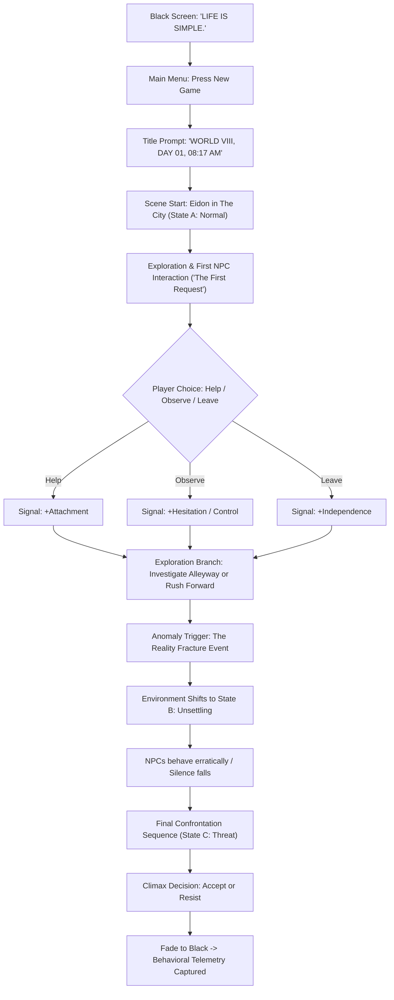

# PRODUCT REQUIREMENTS DOCUMENT (PRD)
## Project: ROUGHTALE8 — Phase 0: Eidon Vertical Slice
**Document Version:** 1.0 (Lean MVP Edition)  
**Author / Product Owner:** EV (Thought Partner & Senior Product Owner)  
**Project Lead & Creator:** Muhammad Faari Akbar (Faari)  
**Engine & Target Baseline:** Unity (URP) | Windows 11 PC (Steam / Standalone)  
**Target Duration:** 15–20 Menit (Playable Self-Contained Slice)  
**Status:** Approved for Technical Execution  

---

## 1. Overview & Vision

### 1.1 Elevator Pitch
**ROUGHTALE8** adalah *psychological choice-driven narrative experience* berlatar dunia ke-8 pasca 7 kehancuran total (*The Final Cycle*). Berbeda dengan game naratif konvensional yang mengandalkan pilihan biner hitam-putih (*good vs. evil*), ROUGHTALE8 membaca **bukan hanya pilihan dialog pemain, melainkan cara pemain mengambil keputusan** melalui sinyal perilaku tersembunyi (*Behavioral Signals*).

### 1.2 Core Thesis & Tagline
> **"LIFE IS SIMPLE."**  
> Frasa yang terasa naif di awal, penuh kontradiksi di tengah, dan menjadi katarsis setelah mencapai *Acceptance*.

### 1.3 Scope Phase 0: Eidon Vertical Slice
Vertical Slice ini adalah batu loncatan pertama produksi (Fase 0). Tujuannya bukan menyelesaikan game penuh 10,5 jam, melainkan **membuktikan secara konkret bahwa *core experience*, atmosfer, dan *silent choice tracking* benar-benar bekerja dan menarik saat dimainkan**.

---

## 2. Problem Statement & Market Positioning

| Aspek | Realitas & Tantangan | Solusi ROUGHTALE8 |
| :--- | :--- | :--- |
| **Kelemahan Game Naratif Saat Ini** | Sering kali terjebak dalam ilusi pilihan (*choice illusion*), *morality meter* yang klise, dan dialog pohon yang terasa seperti kuis logika. | Keputusan dibaca dari **4 tipe aksi**: *Explicit Choice*, *Exploration*, *Timing*, dan *Reaction* spontan. |
| **Kelemahan Horror/Action Saat Ini** | Terlalu bertumpu pada *jump scare* murahan atau *combat grind* yang mengikis bobot psikologis cerita. | Mengusung pendekatan **Light Combat & Atmospheric Tension**: ancaman fisik hadir sebagai tekanan naratif, bukan arena gebuk ber-HP bar. |
| **Benchmark & Inspirasi** | *The Last of Us* (kedalaman relasi emosional), *Silent Hill* (horor psikologis & atmosfer *unsettling*), *Resident Evil* (ketegangan navigasi), *Clair Obscur: Expedition 33* (estetika naratif sinematik). | Memadukan tema sentral psikologis: **Control, Attachment, Pragmatism, Knowledge, Guilt**, menuju **Acceptance**. |

---

## 3. Goals & Success Metrics

### 3.1 Primary Goals (P0)
1. **Experience Validation:** Memvalidasi bahwa transisi atmosfer (3 *Environment States*: Normal → Unsettling → Threat) terasa mencekam dan alami dalam durasi 15–20 menit.
2. **Behavioral Engine Proof-of-Concept:** Membuktikan bahwa sistem dapat mencatat sinyal perilaku (*Control, Attachment, Hesitation*) secara hening di latar belakang tanpa mengganggu *immersion*.
3. **Core Controller Stability:** Memastikan karakter utama (Eidon) memiliki kendali pergerakan orang ketiga (*third-person*) yang responsif, nyaman, dan sinematik di lingkungan kota (*The City*).

### 3.2 Key Performance Indicators (KPIs)
- **Playtest Completion Rate:** $\ge 85\%$ tester menyelesaikan sesi 15–20 menit hingga *end sequence*.
- **Telemetry Fidelity:** $100\%$ sesi playtest berhasil merekam log sinyal perilaku (*Behavioral State Summary*) tanpa eror atau *data loss*.
- **Performance Baseline:** Stabil pada **60 FPS @ 1080p** pada spesifikasi laptop kerja standar (*Lenovo IdeaPad Slim 3 / midrange GPU*).

### 3.3 Explicit Non-Goals (Out of Scope untuk Phase 0)
- **BUKAN Game Penuh:** Tidak memuat Prologue + Act I–V (10,5 jam) dan tidak membuka 5 karakter sekaligus (hanya Eidon yang playable di Phase 0).
- **BUKAN Heavy Action RPG:** Tidak ada sistem leveling, inventory crafting kompleks, health bar musuh, skill tree, atau boss fight mekanikal multi-phase.
- **BUKAN Full Save System:** Tidak memerlukan arsitektur multi-slot cloud save; sistem hanya membutuhkan *checkpoint/reset* lokal sederhana.

---

## 4. Target Users & Player Personas

### Persona A: "The Atmospheric Investigator" (Primary)
- **Profil:** Gamer penyuka *narrative thriller* (*Alan Wake, Silent Hill, SOMA*).
- **Motivasi:** Mencari misteri dunia yang tidak dijelaskan secara gamblang, suka membaca petunjuk lingkungan (*environmental storytelling*), dan peka terhadap perubahan atmosfer audio-visual.
- **Pain Point:** Frustrasi jika game menyuapi cerita dengan eksposisi panjang atau dinding teks tutorial yang merusak suasana.

### Persona B: "The Consequence Seeker" (Secondary)
- **Profil:** Gamer penikmat konsekuensi cerita (*Detroit: Become Human, Until Dawn*).
- **Motivasi:** Ingin melihat bagaimana keputusan kecil (misal memeriksa sudut ruangan atau langsung pergi) berdampak pada sikap dunia dan NPC terhadap dirinya.
- **Pain Point:** Kecewa jika pilihan terbukti palsu (*fake choices*) yang tidak mengubah respons dunia sama sekali.

---

## 5. MVP Scope & System Breakdown

```
ROUGHTALE8 Vertical Slice (Phase 0)
├── Must-Have Systems (P0)
│   ├── [SYS-01] Player Controller (Eidon 3D WASD / Gamepad)
│   ├── [SYS-02] Third-Person Camera System (Smooth Follow & Framing)
│   ├── [SYS-03] Interaction System (Interact / Examine / Talk)
│   ├── [SYS-04] Dialogue & Reaction Engine (Branching & Internal Thoughts)
│   ├── [SYS-05] Decision Map & Behavioral Signal Logger (Control/Attachment/Hesitation)
│   ├── [SYS-06] Atmosphere & Environment State Manager (Normal -> Unsettling -> Threat)
│   └── [SYS-07] Application Flow & Scene Management (Boot, Menu, Slice, Reset)
└── Optional / Phase 1 (P1 - Cut if Blocking)
    ├── [SYS-08] Light Narrative Threat (QTE/Tekanan waktu tanpa HP bar)
    └── [SYS-09] Post-Playtest Telemetry Summary Screen
```

### Rincian 7 Sistem Wajib (P0):
1. **Player Controller:** Karakter Eidon berjalan (*walk*), lari (*run* jika perlu), memeriksa arah pandang, terikat pada gravitasi dan *ground detection* yang kokoh.
2. **Camera System:** Kamera *third-person* mengorbit di belakang Eidon dengan peredam tabrakan (*collision damping*), memberi ruang pandang lega pada atmosfer kota.
3. **Interaction System:** *Context-aware interaction prompt* saat mendekati objek atau NPC (`[E]` untuk Examine / Talk / Interact).
4. **Dialogue & Reaction System:** Menampilkan dialog NPC dan monolog batin Eidon secara dinamis, mendukung pilihan respons cepat bertekanan waktu.
5. **Decision Logger (Silent Engine):** Mengkategorikan setiap aksi ke dalam 3 metrik perilaku:
   - **CONTROL:** Kecenderungan pemain mencari informasi mendalam, mengendalikan situasi, atau ragu bertindak spontan.
   - **ATTACHMENT:** Kecenderungan pemain menolong NPC, kembali memeriksa kondisi orang lain, atau memprioritaskan keselamatan kelompok.
   - **HESITATION:** Waktu jeda atau keraguan sebelum mengambil keputusan penting.
6. **Atmosphere State Engine:** Mengubah pencahayaan (*lighting*), filter warna, *audio ambience*, dan animasi lingkungan di 3 keadaan:
   - **State A (Normal):** Kota terasa hidup, damai, matahari hangat, masyarakat tenang.
   - **State B (Unsettling):** Sesuatu terasa salah—gangguan suara halus, tatapan janggal NPC, anomali kecil.
   - **State C (Threat):** Kesan aman runtuh total—lingkungan menekan, realitas retak.
7. **Flow & Reset Controller:** Menu Utama → Transisi Layar Hitam (*"WORLD VIII, DAY 01, 08:17 AM"*) → Playable Slice → Tombol `[R]` untuk restart instan jika tester ingin mencoba variasi rute.

---

## 6. Features & User Stories (P0)

### Feature 1: Navigasi & Kendali Eidon
- **User Story:** *Sebagai pemain, saya ingin menggerakkan Eidon secara mulus dengan keyboard/mouse atau gamepad di lingkungan kota, sehingga saya dapat menjelajahi dunia dengan nyaman tanpa disorientasi kamera.*
- **Acceptance Criteria (Given / When / Then):**
  - **Given:** Eidon berada di area playable scene `Eidon_VerticalSlice`.
  - **When:** Pemain menekan input arah `W/A/S/D` atau *analog stick*.
  - **Then:** Eidon berotasi menghadap arah gerak secara halus (*slerp*), melangkah dengan kecepatan stabil ($4.25\text{ m/s}$), dan kamera mempertahankan sudut pandang sinematik tanpa menembus dinding (*mesh clipping*).

### Feature 2: Pemeriksaan & Interaksi Kontekstual
- **User Story:** *Sebagai pemain, saya ingin mendekati objek atau warga kota dan melihat indikator interaksi yang jelas, sehingga saya tahu apa yang bisa diperiksa atau diajak bicara.*
- **Acceptance Criteria:**
  - **Given:** Pemain berada dalam radius interaksi ($2\text{ meter}$) dari NPC atau objek penting.
  - **When:** Pemain berada di hadapan target.
  - **Then:** UI interaksi minimalis muncul halus (*fade-in*). Saat tombol `[E]` ditekan, interaksi/dialog langsung terpicu dan input gerak dinonaktifkan sementara.

### Feature 3: Pengambilan Keputusan & Pencatatan Sinyal Perilaku
- **User Story:** *Sebagai pemain, saya ingin dihadapkan pada dilema situasi dan pilihan eksplorasi, sehingga saya merasa memiliki andil terhadap nasib Eidon.*
- **Acceptance Criteria:**
  - **Given:** Pemain menerima permohonan pertolongan pertama (*The First Request*).
  - **When:** Pemain memilih antara `HELP`, `OBSERVE`, atau `LEAVE` (baik via dialog atau langsung berjalan menjauh).
  - **Then:** Sistem secara hening menambahkan bobot pada variabel `ATTACHMENT`, `CONTROL`, atau `INDEPENDENCE` di State Manager tanpa menampilkan angka/indikator visual angka ke layar pemain.

### Feature 4: Transisi Keadaan Atmosfer (Atmosphere States)
- **User Story:** *Sebagai pemain, saya ingin merasakan perubahan ketegangan dunia secara dramatis saat investigasi berlanjut, sehingga rasa horor psikologis terbangun kuat.*
- **Acceptance Criteria:**
  - **Given:** Pemain memicu *Trigger Event Anomaly* di tengah kota.
  - **When:** State berpindah dari State A (*Normal*) ke State B (*Unsettling*).
  - **Then:** Parameter skybox meredup, audio ambiens normal terdistorsi (*detuned ambience*), dan post-processing volume mengaktifkan *vignette* tipis serta *chromatic aberration* halus secara mulus dalam durasi 2–3 detik.

---

## 7. Critical User Flow (Vertical Slice 15–20 Menit)



---

## 8. Non-Functional Requirements (NFRs)

1. **Performance & Optimization:**
   - Target frame rate: $60\text{ FPS}$ konstan pada resolusi $1920\times 1080$.
   - Draw call budget: Di bawah 800 draw calls pada scene kota melalui pemanfaatan *mesh batching* dan *occlusion culling*.
2. **Platform & Portability:**
   - Target awal: Standalone Windows 11 executable (x64) berbasis Unity 6 / URP.
3. **Accessibility & Control Usability:**
   - Dukungan penuh skema Dual-Input: Keyboard + Mouse dan Gamepad Standar (Xbox / PlayStation controller).
   - Tipografi dialog terbaca jelas dengan kontras tinggi (*minimum ratio 4.5:1*) dan ukuran font teks minimal 24pt pada 1080p.

---

## 9. Assumptions & Technical Dependencies

### 9.1 Assumptions
- Proyek Unity di `C:\ROUGHTALE8` (termasuk skrip `EidonPlayerController.cs`, `ThirdPersonCameraController.cs`, dan scene `Eidon_VerticalSlice.unity`) berfungsi sebagai basis teknis utama yang akan disempurnakan.
- Dokumentasi Master Blueprint Revisi 3 dan Vertical Slice Companion Blueprint di folder `GAME PROJECT` adalah sumber kebenaran (*single source of truth*) untuk lore, dialog, dan skenario aksi.

### 9.2 Technical Dependencies
- **Engine:** Unity (URP 2022.3 LTS atau Unity 6).
- **Packages:** Unity Input System (New), TextMeshPro, Cinemachine (opsional jika camera controller vanilla di-upgrade), Universal RP Post-Processing.

---

## 10. Risks, Mitigations & PO Guidelines

| # | Identifikasi Risiko | Tingkat | Rencana Mitigasi (Senior PO) |
| :-: | :--- | :-: | :--- |
| **1** | **Feature Creep Combat:** Godaan menambahkan sistem pertarungan, kombo, atau bilah darah saat adegan ancaman muncul. | **TINGGI** | **STRICT NON-NEGOTIABLE:** Kunci pada prinsip *Light Combat*. Konfrontasi diselesaikan melalui *timing & positioning*, bukan pertukaran damage angka. |
| **2** | **Tester Disconnect:** Pemain tidak menyadari bahwa perilakunya sedang dinilai karena tidak adanya HUD moralitas. | **SEDANG** | Gunakan *audiovisual feedback* terselubung: nada bass rendah sesaat atau mikro-glitch saat sinyal perilaku tercatat. |
| **3** | **Asset Burden:** Pengerjaan visual kota yang memakan waktu terlalu lama menghambat pengujian mekanik. | **SEDANG** | Gunakan metodologi *Greybox First* (`CityGreyboxBuilder.cs` yang sudah ada) dengan pencahayaan dan material warna blok sebelum detail estetika akhir dipoles. |

---

## 11. Release & Exit Criteria (Checklist Kesiapan Rilis Phase 0)

- [ ] **Build:** Build Windows x64 berhasil dikompilasi tanpa *script compilation errors*.
- [ ] **Flow Loop:** Alur dari Main Menu $\rightarrow$ Playable Slice $\rightarrow$ Climax Sequence $\rightarrow$ Telemetry End berjalan mulus tanpa macet (*soft-lock*).
- [ ] **Input Parity:** Pemain dapat menavigasi, berinteraksi, dan memilih opsi menggunakan Keyboard/Mouse dan Gamepad secara setara.
- [ ] **Behavioral Logging:** File log `session_telemetry.json` tercipta secara otomatis di direktori game berisi rekap skor *Control, Attachment, Hesitation* dari sesi tersebut.
- [ ] **Performance Pass:** Tidak ditemukan lonjakan *frame drop* (stutter) di bawah 45 FPS saat transisi State A $\rightarrow$ State B $\rightarrow$ State C.
